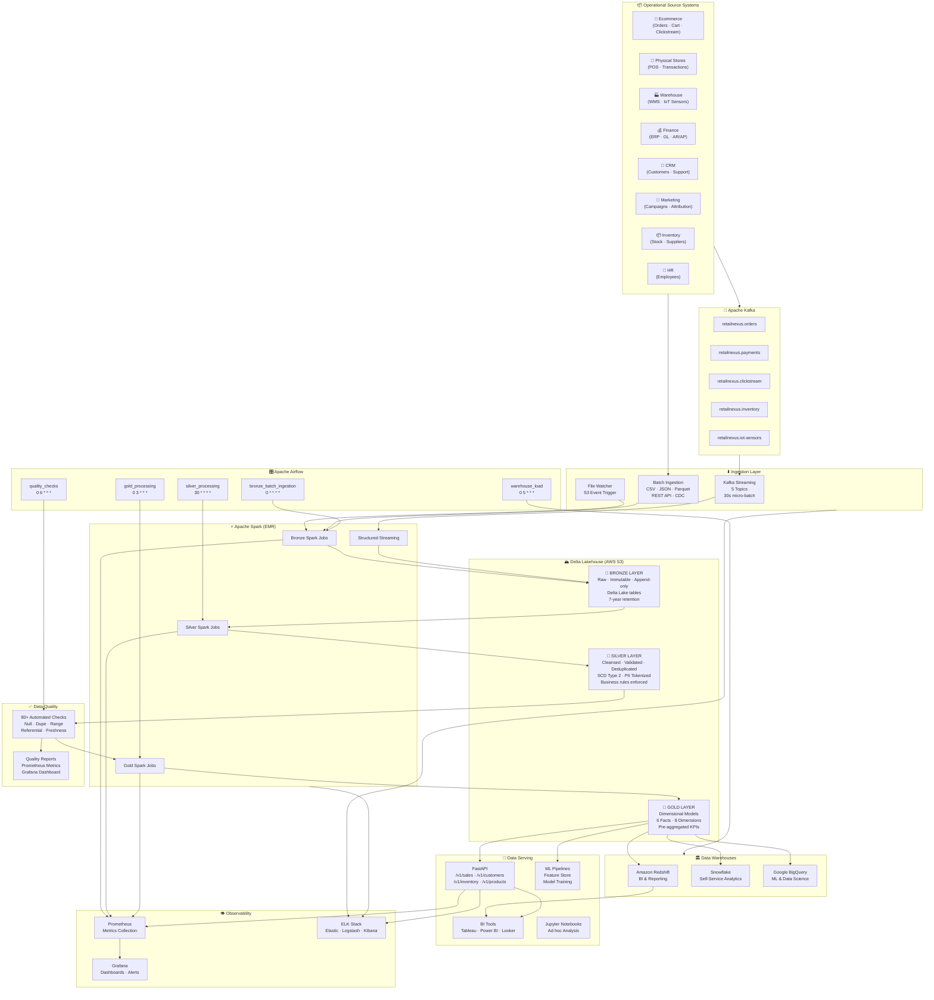
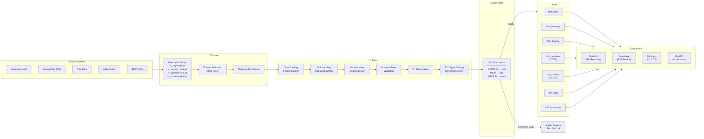
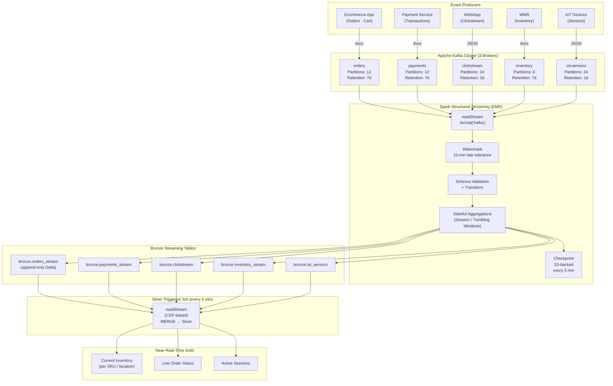
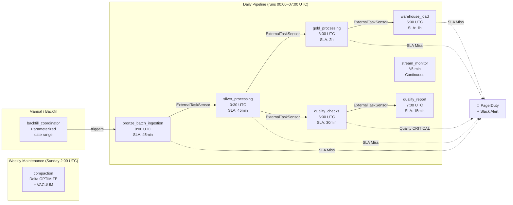
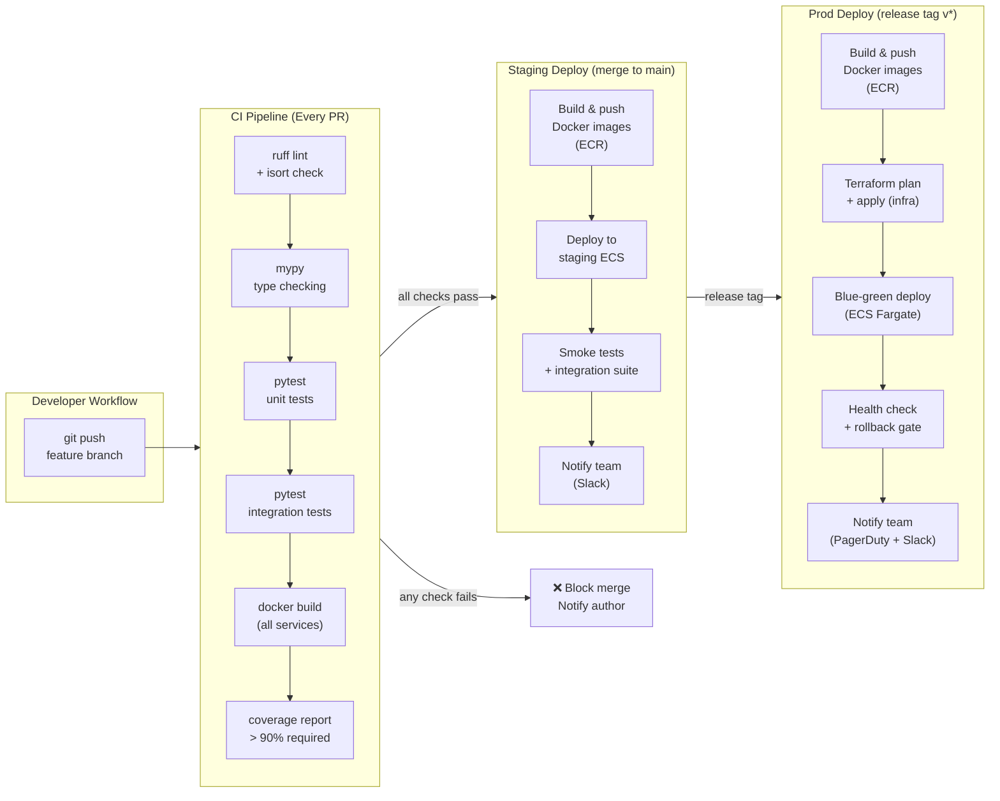
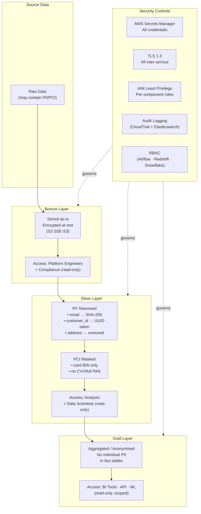
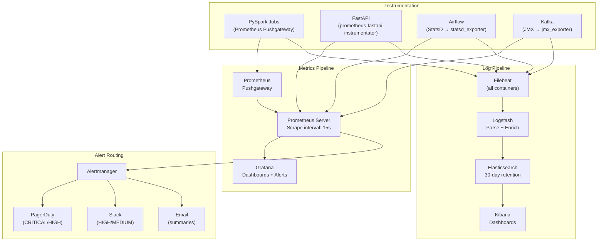
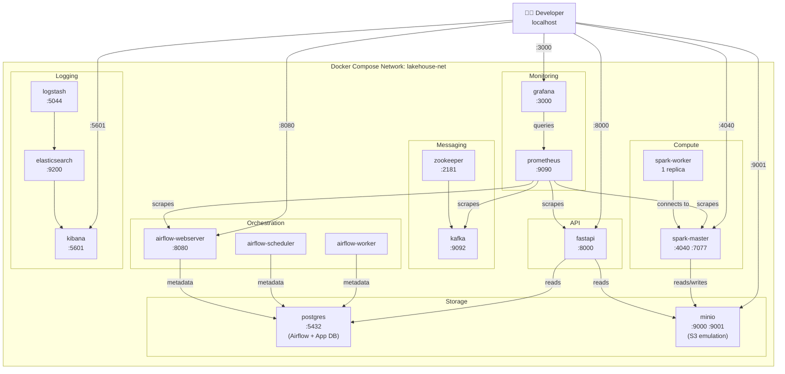
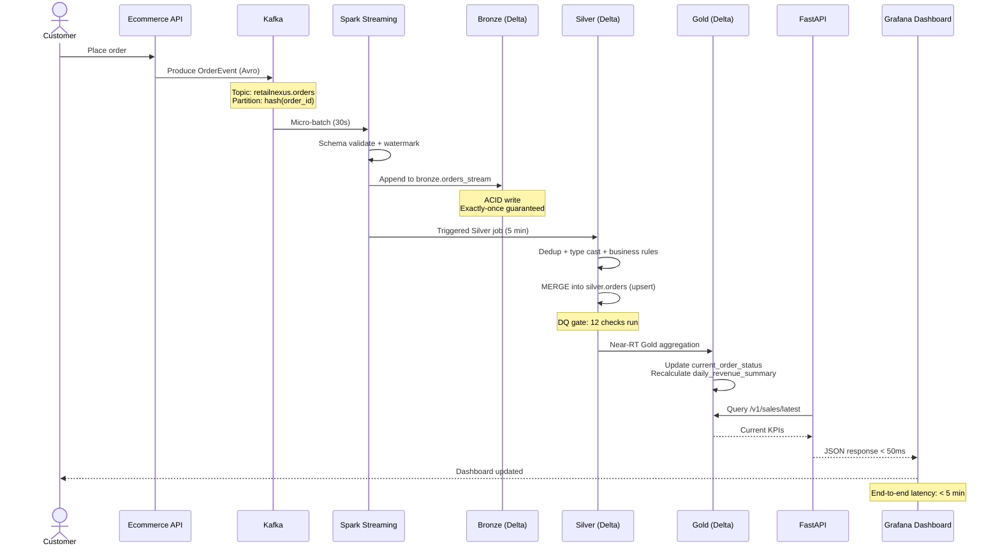

# RetailNexus Data Lakehouse — Architecture Diagrams

All diagrams use [Mermaid](https://mermaid.js.org/) and render natively in GitHub.

---

## Diagram 1 — High-Level System Architecture



---

## Diagram 2 — Medallion Data Flow (Detailed)



---

## Diagram 3 — Streaming Architecture



---

## Diagram 4 — Dimensional Model (Star Schema)

```mermaid
erDiagram
    dim_date {
        int date_key PK
        date full_date
        int year
        int quarter
        int month
        int week
        int day_of_week
        boolean is_holiday
        boolean is_weekend
        string fiscal_year
        string fiscal_quarter
    }

    dim_customer {
        int customer_key PK
        string customer_id NK
        string full_name
        string email_token
        string segment
        string loyalty_tier
        string country_code
        string city
        timestamp valid_from
        timestamp valid_to
        boolean is_current
    }

    dim_product {
        int product_key PK
        string sku NK
        string product_name
        string category_l1
        string category_l2
        string brand
        decimal cost_price
        decimal list_price
        string supplier_id
        timestamp valid_from
        timestamp valid_to
        boolean is_current
    }

    dim_store {
        int store_key PK
        string store_id NK
        string store_name
        string store_type
        string city
        string region
        string country
        int employee_count
        decimal sq_footage
        timestamp valid_from
        timestamp valid_to
        boolean is_current
    }

    dim_promotion {
        int promotion_key PK
        string promotion_id NK
        string promotion_name
        string promotion_type
        decimal discount_pct
        date start_date
        date end_date
    }

    dim_location {
        int location_key PK
        string location_id NK
        string location_type
        string city
        string state
        string country
        string region
        decimal latitude
        decimal longitude
    }

    fact_sales {
        bigint sales_key PK
        int date_key FK
        int customer_key FK
        int product_key FK
        int store_key FK
        int promotion_key FK
        string order_id
        string order_line_id
        string channel
        int quantity
        decimal unit_price
        decimal discount_amount
        decimal net_revenue
        decimal gross_margin
        decimal tax_amount
        string order_status
    }

    fact_inventory {
        bigint inventory_key PK
        int date_key FK
        int product_key FK
        int location_key FK
        int store_key FK
        int quantity_on_hand
        int quantity_reserved
        int quantity_available
        int reorder_point
        decimal inventory_value
        int days_of_supply
    }

    fact_returns {
        bigint return_key PK
        int date_key FK
        int customer_key FK
        int product_key FK
        int store_key FK
        string order_id
        string return_id
        string return_reason
        int quantity_returned
        decimal refund_amount
    }

    fact_shipments {
        bigint shipment_key PK
        int date_key FK
        int location_key FK
        string order_id
        string shipment_id
        string carrier
        string status
        date estimated_delivery
        date actual_delivery
        int transit_days
        decimal shipping_cost
    }

    dim_date ||--o{ fact_sales : "date_key"
    dim_customer ||--o{ fact_sales : "customer_key"
    dim_product ||--o{ fact_sales : "product_key"
    dim_store ||--o{ fact_sales : "store_key"
    dim_promotion ||--o{ fact_sales : "promotion_key"
    dim_date ||--o{ fact_inventory : "date_key"
    dim_product ||--o{ fact_inventory : "product_key"
    dim_location ||--o{ fact_inventory : "location_key"
    dim_date ||--o{ fact_returns : "date_key"
    dim_customer ||--o{ fact_returns : "customer_key"
    dim_product ||--o{ fact_returns : "product_key"
    dim_date ||--o{ fact_shipments : "date_key"
    dim_location ||--o{ fact_shipments : "location_key"
```

---

## Diagram 5 — Airflow DAG Dependencies



---

## Diagram 6 — CI/CD Pipeline



---

## Diagram 7 — Security & Data Governance



---

## Diagram 8 — Monitoring & Observability Stack



---

## Diagram 9 — Local Development Stack (Docker Compose)



---

## Diagram 10 — Sequence: End-to-End Order Event


